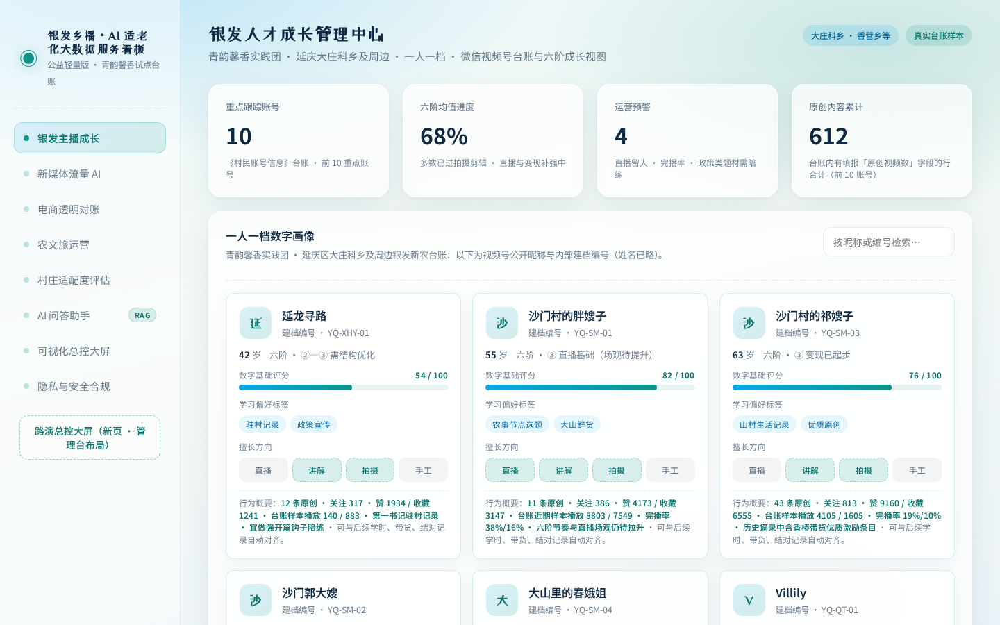
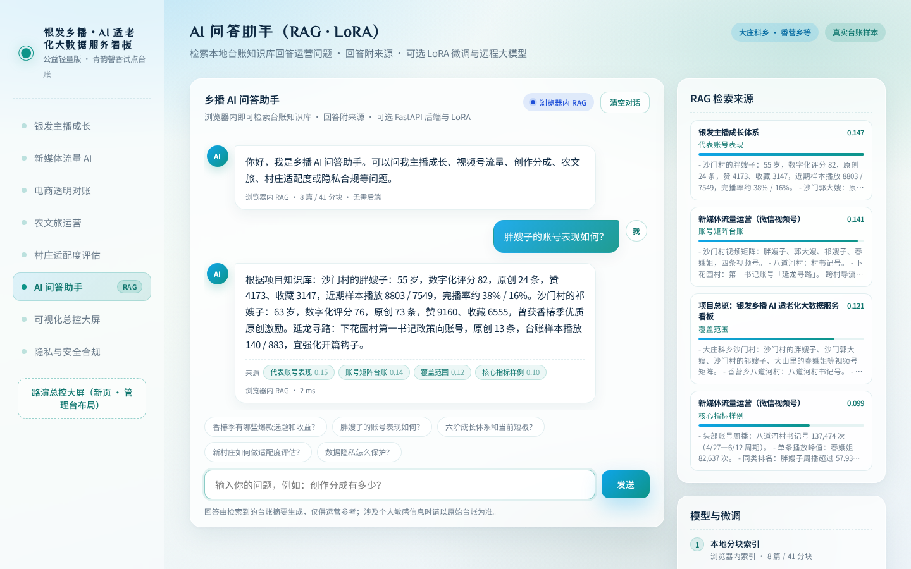
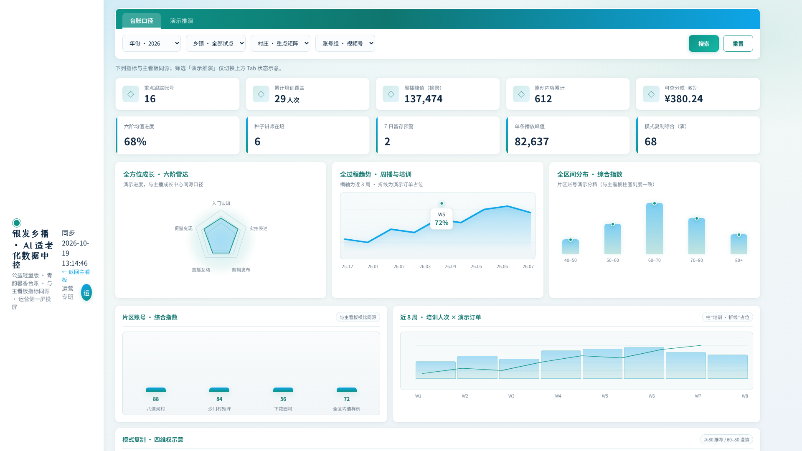

# 银发乡播 · AI 适老化大数据服务看板

乡村助农模式可复制评估体系与数据中控可视化平台（公益轻量版）

**在线演示**：<https://qingwanruojun.github.io/wangye/>



## 功能模块

- **银发主播成长** — 一人一档数字画像、六阶成长路径与活跃度预警
- **新媒体流量运营** — 视频号账号矩阵、选题方向与运营短板
- **电商透明对账** — 创作分成、直播收入与农户侧分成样例
- **农文旅运营** — 乡村旅游与文化活动运营看板（演示数据已标识）
- **村庄适配度评估** — AHP 十二项指标、A/F/RVCPM 公式与四象限判读
- **可视化总控大屏** — 路演用大字总控管理台
- **隐私与安全合规** — 脱敏、权限与备份说明
- **AI 问答助手** — 检索本地知识库回答运营问题，回答附来源与相似度





## AI 助手怎么工作

助手默认在**浏览器内**完成检索，不需要服务器，静态托管即可使用：

1. `scripts/build_rag_index.py` 读取 `server/knowledge_base/`，生成静态索引 `js/rag-index.js`
2. `js/browser-rag.js` 在浏览器里执行与后端一致的 TF-IDF 余弦检索和句子抽取
3. 回答附带命中的知识库片段、章节与相似度；未命中时明确提示换问法

检测到 FastAPI 后端时自动切换到后端模式，可进一步使用大模型生成：

| 模式 | 触发条件 | 说明 |
| --- | --- | --- |
| 浏览器内 RAG | 默认，无需后端 | 静态部署即可，本地检索 + 抽取式回答 |
| 抽取式 RAG | 启动后端，未配置 LLM | 与浏览器模式同源的 Python 实现 |
| LLM + RAG | 配置 `LLM_*` 环境变量 | 检索结果交给 OpenAI 兼容接口生成 |
| LoRA + RAG | 设置 `LOCAL_MODEL_PATH` | 本地模型 + LoRA 适配器生成 |

## 快速开始

### 方式一：直接打开（零依赖）

双击 `index.html`，或用任意静态服务器：

```bash
python3 -m http.server 8080
```

访问 <http://127.0.0.1:8080>。AI 助手会使用浏览器内检索。

### 方式二：完整后端（可选）

```bash
pip install -r server/requirements.txt
python -m uvicorn server.app:app --host 127.0.0.1 --port 8000
```

打开 <http://127.0.0.1:8000>，页面与问答接口同源提供。

可选环境变量：

- `LLM_BASE_URL` / `LLM_API_KEY` / `LLM_MODEL`：OpenAI 兼容接口
- `LOCAL_MODEL_PATH` / `LORA_ADAPTER_PATH`：本地模型与 LoRA 适配器

### 修改知识库后重建索引

```bash
python3 scripts/build_rag_index.py
```

修改 `server/knowledge_base/` 下的 Markdown 后执行；后端重启即可生效，静态模式需重新生成索引。

## LoRA 微调（可选）

```bash
pip install -r server/requirements-training.txt
python3 server/training/prepare_dataset.py
python3 server/training/train_lora.py --model Qwen/Qwen2.5-0.5B-Instruct
```

适配器默认输出到 `server/training/output/lora-adapter`。当前训练集为演示规模，适合流程验证，不建议直接作为生产模型。

## 部署到 GitHub Pages

1. 推送仓库到 GitHub
2. Settings → Pages → 选择 `main` 分支 `/ (root)`
3. 访问 `https://<用户名>.github.io/<仓库名>/`

仓库已包含 `.nojekyll`，静态页面与浏览器内 AI 检索可直接运行。完整后端（LLM / LoRA）需要单独部署 Python 服务。

## 目录结构

```text
index.html                 主看板
bigscreen.html             路演总控大屏
css/                       样式
js/main.js                 主看板交互
js/assistant.js            AI 助手前端（后端探测、对话、来源展示）
js/browser-rag.js          浏览器内检索实现
js/rag-index.js            由脚本生成的知识库索引
scripts/build_rag_index.py 生成静态索引
server/                    FastAPI 后端、知识库与训练脚本
docs/screenshots/          README 截图
```

## 数据与隐私说明

- 主播账号的原创条数、播放、点赞、收藏与创作分成来自项目台账和视频号后台摘录。
- 农文旅板块的满意度、客源地、活动人次与金额为演示虚拟数据，页面已标识。
- 本仓库中的账号信息已做昵称化处理，不包含姓名、电话、证件号或原始 Excel 台账；原始敏感数据不会提交到仓库。
- 公开演示时请继续遵守项目的数据使用约定，不要上传未脱敏的村民信息。
